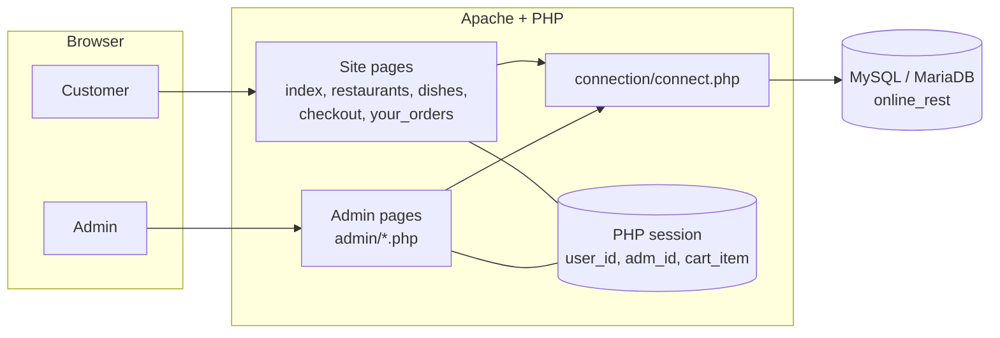
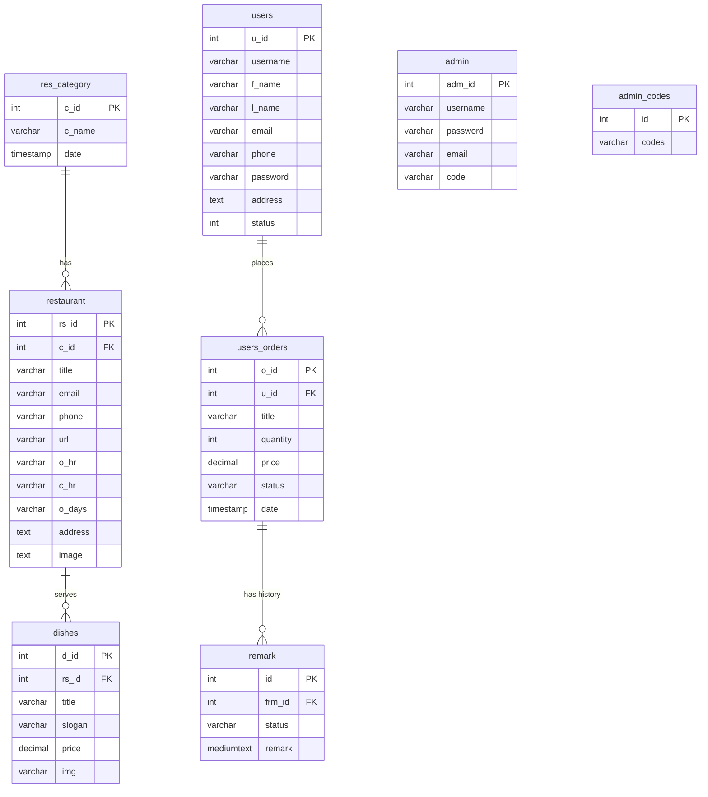
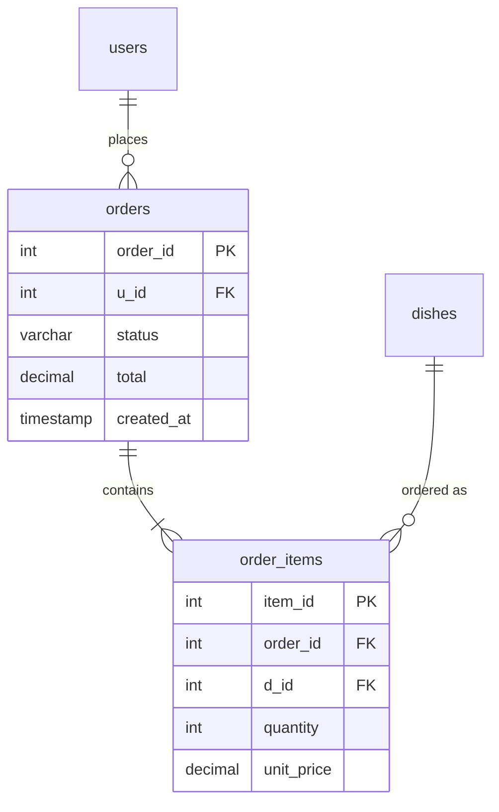

# Project Blueprint

The technical design of the application: how it is structured, how the data is organised, and how the pieces connect.

---

## 1. Architecture

A classic **two-tier, server-rendered** PHP application. There is no separate API or framework: every page is a PHP file that queries the database and prints HTML.



**Key points**
- `connection/connect.php` is included by every page and creates the `$db` connection shared by site and admin.
- Login state is held in the session: `user_id` for customers, `adm_id` for admins.
- The shopping cart is held in the session (`cart_item`), not in the database.
- Images for restaurants and dishes are uploaded files under `admin/Res_img/` and `admin/Res_img/dishes/`; their file names are stored in the database.

---

## 2. Database design

Database name: `online_rest`, 8 tables.



`admin` and `admin_codes` are standalone: `admin_codes` holds the codes that allow someone to create a new admin account.

### Table notes

| Table | Purpose |
|---|---|
| `res_category` | Cuisine categories (grill, pizza, pasta, thaifood, fish) |
| `restaurant` | Restaurants with contact data, opening hours/days, address, image |
| `dishes` | Menu items linked to a restaurant, with price and image |
| `users` | Customer accounts |
| `users_orders` | One row per ordered cart item |
| `remark` | Admin comments each time an order status is changed (`frm_id` = order id) |
| `admin` | Admin accounts |
| `admin_codes` | Registration codes for new admins |

### Design observations (honest review)

- **No foreign key constraints** are declared in the SQL dump. The relationships in the diagram are logical, enforced only by the PHP code.
- `users_orders` stores the dish **title** and **unit price** as text/number, not `d_id`. Good side: old orders keep the price they were bought at. Bad side: renaming a dish breaks the link, and counting "most ordered dish" has to group by title.
- There is **no order header**. One checkout with 3 dishes creates 3 unrelated rows, so "an order" as a single unit does not exist in the database.
- `restaurant.o_hr`, `c_hr`, `o_days` are plain `varchar` text, not time/date types.

---

## 3. Module overview

| Module | Files | Responsibility |
|---|---|---|
| Authentication (customer) | `login.php`, `registration.php`, `logout.php` | Create account, start/end session |
| Catalogue | `index.php`, `restaurants.php`, `dishes.php` | Show categories, restaurants, dishes |
| Cart | `product-action.php` | Session cart: add / remove / empty |
| Ordering | `checkout.php`, `your_orders.php`, `delete_orders.php` | Place, view and cancel orders |
| Admin authentication | `admin/index.php`, `admin/logout.php` | Admin login and registration (with code) |
| Admin: dashboard | `admin/dashboard.php` | Totals |
| Admin: users | `allusers`, `add_users`, `update_users`, `delete_users`, `userprofile` | User CRUD |
| Admin: stores | `allrestraunt`, `add_restraunt`, `update_restraunt`, `delete_stores`, `update_category`, `delete_category` | Restaurant and category management |
| Admin: menu | `all_menu`, `update_menu`, `delete_menu` | Dish management |
| Admin: orders | `all_orders`, `view_order`, `order_update`, `delete_orders` | Order handling |
| Shared | `connection/connect.php` | DB connection |
| Presentation | `css/`, `js/`, `scss/`, `fonts/`, `images/` | Theme and third-party libraries |

---

## 4. Access control (as implemented)

This is what the code *does* today, not what it should do.

| Area | Check in code | Result |
|---|---|---|
| `checkout.php`, `your_orders.php` | `empty($_SESSION["user_id"])` → redirect to login | Protected |
| `admin/dashboard.php` | `empty($_SESSION["adm_id"])` → redirect | Protected |
| `admin/order_update.php`, `admin/userprofile.php` | check `user_id` (customer session) | Wrong variable: a logged-in customer passes, an admin does not |
| Other `admin/*.php` pages incl. delete scripts | none found | Reachable without logging in |
| `delete_orders.php` (customer) | none | Any order id can be deleted via the URL |

**Target design:** one `admin/auth.php` that checks `adm_id` and is included first in every admin page; customer actions verify the row belongs to `$_SESSION["user_id"]`.

---

## 5. Folder blueprint

```
Recommendation-Based Food Ordering Website/
├── index.php  restaurants.php  dishes.php  checkout.php  your_orders.php
├── login.php  registration.php  logout.php  delete_orders.php  product-action.php
├── connection/
│   └── connect.php
├── admin/
│   ├── index.php  dashboard.php  logout.php
│   ├── allusers / add_users / update_users / delete_users / userprofile
│   ├── allrestraunt / add_restraunt / update_restraunt / delete_stores
│   ├── update_category / delete_category
│   ├── all_menu / update_menu / delete_menu
│   ├── all_orders / view_order / order_update / delete_orders
│   ├── Res_img/ (uploaded restaurant + dish images)
│   └── css/ js/ icons/ images/ (admin theme assets)
├── css/  js/  scss/  fonts/  images/
├── SQL/online_rest.sql   (2018 dump)
└── online_rest.sql       (2020 dump — use this)
```

---

## 6. Suggested next-version design

If the project is continued, this is the small change set that fixes the biggest design problems:



With `order_items.d_id`, "most ordered dish" becomes a simple `GROUP BY d_id`, which is the data foundation for the recommendation feature described in [PROJECT_DOCUMENTATION.md](PROJECT_DOCUMENTATION.md#8-future-work).
