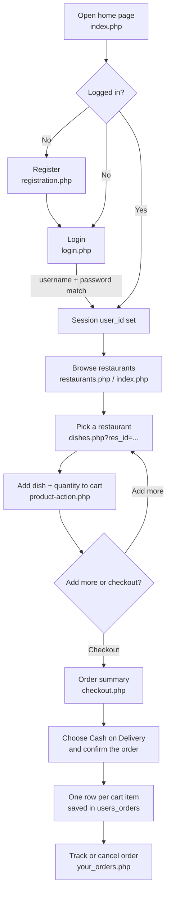
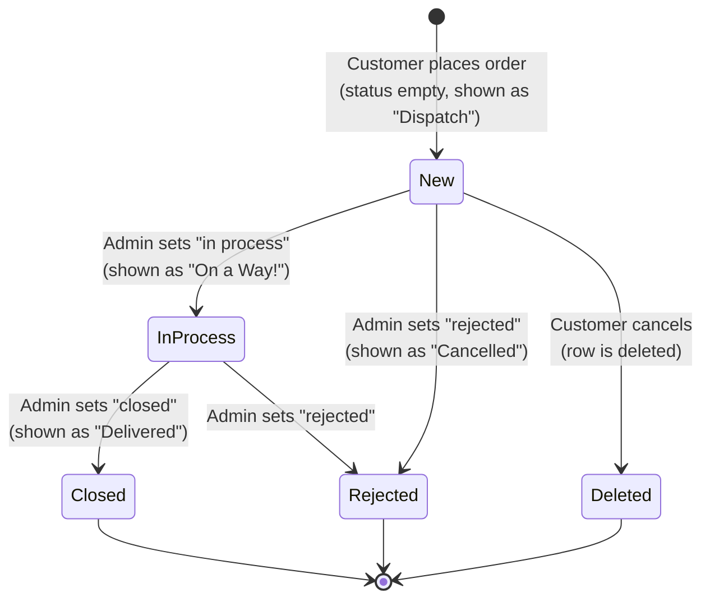
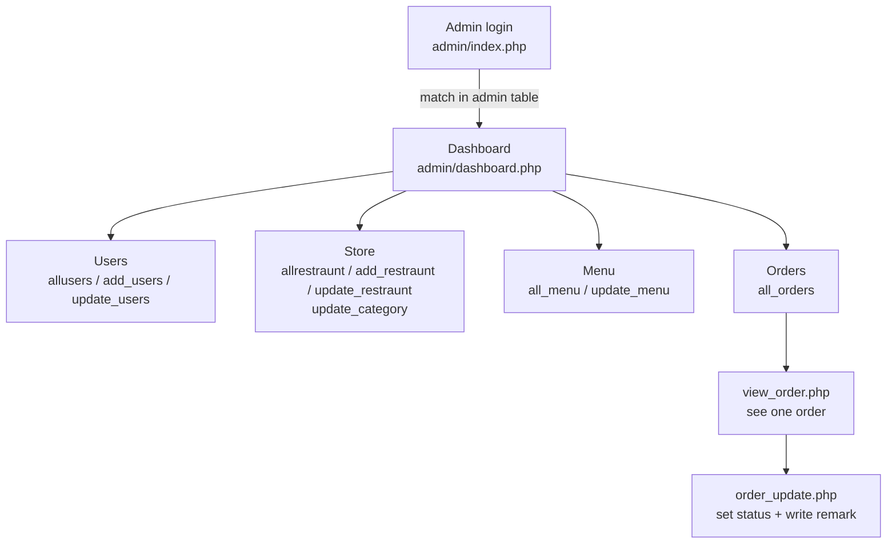

# Project Workflow

How the system behaves from the user's point of view. Everything below was traced from the source code: the file names in brackets are the pages that do the work.

---

## 1. Customer journey

**Notes**
- The cart lives in the PHP session (`$_SESSION["cart_item"]`), so it is lost on logout or when the session ends.
- Adding the same dish twice increases its quantity instead of creating a second line.
- `checkout.php` redirects to `login.php` if there is no logged-in customer.
- Payment options: **Cash on delivery** works; **PayPal** is displayed but disabled.

---

## 2. Cart actions

`dishes.php` includes `product-action.php`, which reads `?action=` from the URL.

| `action` | What it does |
|---|---|
| `add` | Looks up the dish by id (prepared statement) and adds it, or increases quantity if already in the cart |
| `remove` | Removes one dish from the cart |
| `empty` | Clears the whole cart |
| `check` | Redirects to `checkout.php` |

---

## 3. Order status lifecycle

The admin changes the status in `admin/order_update.php`. The customer sees it in `your_orders.php`.

Each admin status change also writes a row to the `remark` table (order id, status, remark text, date), so there is a small history of what the admin wrote.

**Important:** the code does not force this order. The admin can pick any of the three statuses at any time, and "cancel" by the customer is a hard delete, not a status.

---

## 4. Admin workflow

Dashboard tiles show the total number of restaurants, dishes, users and orders (simple `SELECT *` row counts).

Admin registration exists on the admin login page. A new admin must enter a **one-time registration code** that exists in the `admin_codes` table; once used, the code is stored on the new admin row and is rejected as "already redeemed" next time.

---

## 5. Request → page → table map

| Action | Page | Tables touched |
|---|---|---|
| Register | `registration.php` | `users` (read to check duplicates, then insert) |
| Login | `login.php` | `users` |
| List restaurants / categories | `index.php`, `restaurants.php` | `restaurant`, `res_category` |
| View a menu | `dishes.php` | `restaurant`, `dishes` |
| Place order | `checkout.php` | `users_orders` (insert) |
| View my orders | `your_orders.php` | `users_orders` |
| Cancel an order | `delete_orders.php` | `users_orders` (delete) |
| Admin login | `admin/index.php` | `admin` |
| Update order status | `admin/order_update.php` | `remark` (insert), `users_orders` (update) |
| Manage users / restaurants / dishes | `admin/*.php` | `users`, `restaurant`, `dishes`, `res_category` |

---

## 6. Development workflow I would use if rebuilding this

1. Requirements and user stories (customer, admin)
2. Database design (ER diagram → tables)
3. Static pages with Bootstrap
4. PHP logic for register/login, then menu, cart, checkout, orders
5. Admin panel
6. Manual testing with the checklist in [PROJECT_DOCUMENTATION.md](PROJECT_DOCUMENTATION.md#7-testing)
7. Security pass (prepared statements, password hashing, access checks)
